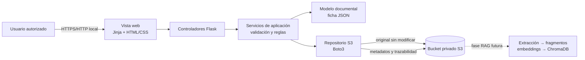

# Carga de programaciones didácticas · DocIA+

Aplicación web educativa para que usuarios autorizados incorporen programaciones didácticas a un bucket privado de Amazon S3. Conserva cada archivo original junto con una ficha JSON para identificarlo, localizarlo y prepararlo en una fase posterior para un flujo RAG.

**Alcance actual:** autenticación local, subida validada, detección de archivos idénticos, aviso de posibles revisiones, catálogo y descarga íntegra. **No extrae ni trocea texto, no genera embeddings y no publica documentos en ChromaDB.** El estado “guardado” confirma la carga técnica; “borrador/final” es una declaración del usuario, no una aprobación institucional.

## Arquitectura



Es una arquitectura **Modelo–Vista–Controlador (MVC)** por capas, con un adaptador de repositorio para separar la aplicación de S3:

- **Modelo:** `app/models/` representa la ficha documental y las cuentas locales.
- **Vista:** `app/templates/` usa plantillas Jinja con escape HTML automático; `app/static/` contiene CSS propio.
- **Controlador:** `app/controllers/` atiende el acceso, las subidas, las búsquedas y las descargas.
- **Servicios:** `app/services/` comprueba metadatos, formatos, SHA-256 y relaciones entre cargas.
- **Repositorio:** `app/repositories/s3_repository.py` lee y escribe archivos JSON y objetos en S3.
- **Seguridad:** `app/security.py` gestiona sesión, permisos, CSRF y límite local de intentos.

### Tecnologías

| Área | Tecnología |
|---|---|
| Lenguaje y servidor web | Python 3.11/3.12, Flask, Waitress |
| Interfaz | HTML, Jinja, CSS y formularios accesibles |
| Almacenamiento persistente | Amazon S3 mediante Boto3; originales y fichas JSON |
| Documentos | PyPDF para lectura estructural de PDF; python-docx para DOCX; UTF-8 para TXT |
| Cuentas del piloto | Archivo JSON local fuera del repositorio; contraseñas con scrypt de Werkzeug |
| Configuración local | `.env` no versionado, con permisos privados en macOS/Linux |
| Pruebas | pytest y un doble S3 en memoria; pruebas locales sin credenciales AWS |

S3 guarda objetos; no ejecuta la aplicación. El servidor Flask/Waitress se ejecuta en el ordenador o servidor del aula. Para el piloto no hay MongoDB ni base SQL. El cuaderno Colab crea y comprueba el bucket; no aloja la web.

## Qué hace la aplicación

- Inicia y cierra sesión de cuentas creadas por el docente.
- Permite adjuntar PDF, DOCX y TXT UTF-8, hasta 20 MiB por archivo (ajustable).
- Solicita título, enseñanza, módulo, curso, declaración borrador/final, procedencia y notas.
- Comprueba campos, curso y pertenencia del módulo a la enseñanza seleccionada.
- Comprueba firma básica/formato, lectura, tamaño y archivo vacío. Rechaza documentos cifrados, dañados o DOCX con macros/objetos incrustados. Permite PDF escaneados, que podrían requerir OCR en una fase posterior.
- Calcula SHA-256 en el servidor. El mismo contenido no se registra dos veces aunque cambie el nombre.
- Avisa cuando un archivo diferente tiene la misma identidad centro + enseñanza + módulo + curso. Permite declararlo revisión o complemento y conservar la relación y el motivo. Ningún original se sobrescribe.
- Permite filtrar por título, módulo, curso y declaración de estado.
- Muestra ficha y SHA-256; la descarga autenticada vuelve a comprobar la integridad.
- Guarda el original y la ficha en S3. Si no se confirma el guardado de la ficha, no muestra éxito.

### Estructura de objetos S3

```text
s3://<bucket>/<prefijo>/
├── originales/<uuid>/original.pdf     # también .docx o .txt
└── fichas/<uuid>.json
```

La “carpeta” es un prefijo de claves de S3. El identificador UUID enlaza ambos objetos; el nombre original se conserva en la ficha, pero no se utiliza como ruta.

Ejemplo de ficha simplificada:

```json
{
  "id": "<uuid>",
  "titulo": "Programación de Sistemas de Big Data",
  "centro": "IES Ataúlfo Argenta",
  "ensenanza": "IABD",
  "modulo": "SBD",
  "curso_academico": "2026-2027",
  "estado_declarado": "final",
  "procedencia": "Departamento de Informática",
  "archivo": {
    "clave_s3": "programaciones/originales/<uuid>/original.pdf",
    "nombre_original": "Programacion_SBD.pdf",
    "tipo_mime": "application/pdf",
    "tamano_bytes": 452810,
    "sha256": "<huella calculada en el servidor>"
  },
  "relacion": null,
  "registro": {
    "usuario": "profesor01",
    "fecha": "<fecha ISO 8601 UTC>",
    "estado": "guardado"
  }
}
```

## Relación con el RAG futuro

Cuando se desarrolle el procesamiento, la ficha será el índice del original: la aplicación o el trabajador de ingesta lee `fichas/<uuid>.json`, obtiene `archivo.clave_s3` y descarga ese objeto. Así no se emparejan archivos mediante nombres adivinados.

El flujo previsto es:

```text
Ficha S3 → clave del original → extracción con página/apartado
         → fragmentos con document_id y metadatos → embeddings → ChromaDB
```

Cada fragmento en ChromaDB debería incluir `document_id` (UUID de la ficha), curso, módulo, título, clave de fuente y localizador (página o apartado), además del texto y un identificador de fragmento estable. El RAG podrá citar el origen y la página y filtrar por curso/módulo. No necesita copiar la ficha completa en cada fragmento.

Antes de indexar hace falta definir aprobación y vigencia: la versión actual solo registra si el usuario declara borrador o final; no decide validez oficial ni retira automáticamente versiones previas.

## Estructura del proyecto

```text
.
├── app/
│   ├── controllers/            # rutas HTTP de acceso y documentos
│   ├── models/                 # ficha documental y usuarios
│   ├── repositories/           # adaptador Amazon S3
│   ├── services/               # validación y reglas de negocio
│   ├── static/css/              # diseño visual local
│   ├── templates/               # login, catálogo, alta, detalle y errores
│   ├── __init__.py              # fábrica Flask, configuración y cabeceras
│   └── security.py               # CSRF, sesión, permisos y límite de intentos
├── config/catalogo.json         # enseñanzas, módulos y cursos permitidos
├── docs/                        # validación e IAM orientativo
├── instance/                    # cuentas locales, ignoradas por Git
├── scripts/                     # asistentes para AWS y creación de usuarios
├── tests/                       # pruebas HTTP y de reglas con S3 simulado
├── Crear_bucket_S3_AWS_Academy.ipynb
├── Configurar_AWS.command       # atajo macOS: pide credenciales ocultas
├── Iniciar_aplicacion.command   # atajo macOS
├── .env.example                 # plantilla sin secretos
├── requirements.txt             # dependencias de ejecución
├── requirements-dev.txt         # dependencias de pruebas
├── requirements-lock.txt        # versiones probadas
└── run.py                       # arranque Waitress, un único proceso
```

## Requisitos

- Python 3.11 o 3.12.
- Cuenta y bucket privado de Amazon S3 con permisos disponibles en AWS Academy.
- Región y credenciales temporales vigentes del laboratorio.
- Conexión de red al endpoint S3 desde el ordenador que ejecuta la web.

## Despliegue local

### macOS / Linux

```bash
cd Gestor_programaciones_profesor
python3 -m venv .venv
source .venv/bin/activate
python -m pip install -r requirements.txt
cp .env.example .env
python -c "import secrets; print(secrets.token_hex(32))"
```

Pega la clave aleatoria en `SECRET_KEY` de `.env`; configura bucket, región y prefijo. Genera la clave dentro del equipo local y no la compartas.

### Windows PowerShell

```powershell
cd Gestor_programaciones_profesor
py -3.12 -m venv .venv
.venv\Scripts\Activate.ps1
python -m pip install -r requirements.txt
Copy-Item .env.example .env
```

### Crear un usuario y arrancar

Con las credenciales AWS configuradas:

```bash
python scripts/crear_usuario.py profesor01
python run.py
```

El script solicita la contraseña de forma oculta (mínimo 12 caracteres) y guarda su hash en `instance/users.json`; nunca se incluye usuario/contraseña por defecto. Abre la URL local que imprima el servidor (por defecto `http://127.0.0.1:5000`). La aplicación utiliza Waitress sin modo debug.

Para iniciar con doble clic en macOS se incluyen `Configurar_AWS.command` e `Iniciar_aplicacion.command`. El `.env` local puede seleccionar el puerto 5050, según el equipo; asegúrate de arrancar una sola instancia por prefijo S3.

### Crear el bucket con Google Colab

Abre `Crear_bucket_S3_AWS_Academy.ipynb` en Google Colab, inicia el laboratorio y ejecuta las celdas en orden. El cuaderno pide Access Key ID, Secret Access Key y Session Token con campos ocultos. No contiene credenciales ni las exporta a Drive o a un archivo. Crea o reutiliza un bucket, comprueba la región, bloqueo de acceso público, ACL deshabilitadas y cifrado SSE-S3, y ejecuta una prueba temporal de escritura/lectura/listado.

Al concluir, desconecta y elimina el entorno de ejecución de Colab. El cuaderno no borra el bucket ni los documentos.

### Configurar credenciales temporales de AWS Academy

1. Inicia el laboratorio y abre **AWS Details → AWS CLI → Show**.
2. En macOS ejecuta `Configurar_AWS.command` o `.venv/bin/python scripts/configurar_aws.py` desde Terminal. En Windows/Linux usa el script Python dentro del entorno virtual.
3. Introduce los tres valores enmascarados: Access Key ID, Secret Access Key y Session Token. No pegues credenciales en el chat ni en el repositorio.
4. El asistente valida identidad de STS, acceso/propiedad del bucket y permiso de listado; si algo falla, no escribe credenciales.
5. Si la validación pasa, guarda los valores en `.env` con permisos privados. Reinicia la aplicación al actualizar el `.env`.
6. Al caducar la sesión del laboratorio, repite el proceso con nuevas credenciales.

Alternativamente, usa un perfil AWS CLI con `aws_session_token` configurado. No mezcles un perfil con variables de credenciales en `.env`. Las cuentas de usuario del gestor son locales a la aplicación; no son usuarios IAM de AWS.

### Configuración de S3 y permisos

El cuaderno propone bloqueo completo del acceso público, `BucketOwnerEnforced` (ACL deshabilitadas) y cifrado SSE-S3. La aplicación usa escrituras condicionales para impedir sobrescribir objetos con una misma clave. El bucket debe permanecer privado; la descarga pasa por la web autenticada y no requiere CORS.

`docs/iam-policy.example.json` documenta los permisos mínimos orientativos de ejecución de la aplicación sobre el prefijo. Crear/configurar un bucket puede necesitar acciones IAM adicionales que AWS Academy quizá restrinja; utiliza los permisos que provea el laboratorio. La aplicación no crea el bucket ni políticas IAM.

No habilites alojamiento web estático para la aplicación: S3 aloja objetos y el servidor Waitress ejecuta Python. Para compartir la web en la red del centro, despliega el servidor en un equipo administrado, limita el acceso de red y utiliza HTTPS con `COOKIE_SECURE=true` y una gestión de identidad apropiada.

## Configuración

`.env.example` enumera los parámetros. Los principales son:

| Variable | Propósito |
|---|---|
| `SECRET_KEY` | Firma cookies de sesión; genera una clave aleatoria por instalación |
| `S3_BUCKET` | Nombre del bucket sin `s3://` |
| `AWS_DEFAULT_REGION` | Región del bucket |
| `S3_PREFIX` | Prefijo del corpus, por defecto `programaciones` |
| `AWS_PROFILE` | Perfil local alternativo; no lo combines con credenciales directas |
| `MAX_FILE_MB` | Tamaño máximo, por defecto 20 |
| `HOST`, `PORT` | Dirección local, por defecto 127.0.0.1:5000 |
| `COOKIE_SECURE` | Actívalo solo cuando el despliegue use HTTPS |

Edita `config/catalogo.json` para añadir módulos/cursos. Enseñanza y módulo se validan en servidor.

## Pruebas y comprobación

```bash
python -m pip install -r requirements-dev.txt
python -m pytest -q
python -m compileall -q app scripts run.py
```

Los tests usan un S3 simulado en memoria y no leen `.env` ni contactan AWS. También se hizo una prueba integrada con un TXT sintético temporal en el bucket configurado: subida de original y ficha, descarga idéntica y rechazo de una segunda carga con el mismo contenido. Los objetos temporales de esa prueba se eliminaron. Detalle en `docs/VALIDACION.md`.

## Límites y decisiones de esta versión

- La aplicación está pensada para un corpus pequeño de aula; cada listado lee fichas JSON de S3 y filtra en Python.
- Arranca un solo proceso. El bloqueo de duplicados coordina hilos de ese proceso, no varias instancias. No se deben ejecutar varias copias contra el mismo prefijo.
- Original y ficha son dos objetos separados; S3 no ofrece una transacción para ambos. El repositorio confirma la ficha antes de informar éxito e intenta tratar fallos parciales, que pueden dejar objetos huérfanos si el proceso se interrumpe.
- Se conservan documentos; no hay borrado ordinario, edición de ficha, aprobación docente ni publicación/despublicación RAG.
- El SHA-256 identifica bytes iguales. No demuestra autoría, autenticidad, vigencia ni igualdad semántica.
- La inspección de archivos es básica; no incluye antivirus ni OCR. Los documentos del piloto deben estar autorizados y no contener datos personales fuera del alcance docente.
- El limitador de intentos vive en memoria del proceso. No sustituye un proveedor institucional de identidad ni protección para un servicio de producción expuesto a internet.
- El bucket, las credenciales de AWS y `instance/users.json` no forman parte de la publicación. Consulta la política de conservación del laboratorio y conserva copias seguras del corpus.

## Seguridad de secretos

No hagas commit de `.env`, credenciales AWS, `instance/users.json`, contraseñas, archivos de programación del centro ni salidas de Colab. Antes de publicar, confirma `git status --ignored` y `git check-ignore .env instance/users.json`. Si una clave temporal se expone, detén/renueva la sesión en AWS Academy y genera credenciales nuevas.

## Licencia

Este repositorio no declara una licencia de reutilización. La visibilidad pública permite consultar el código; los derechos de reutilización no se ceden automáticamente.
