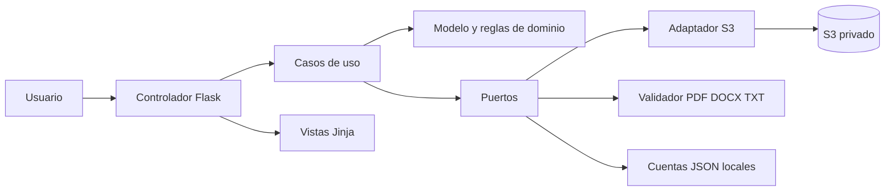

# Skill completa para implementar CargaDocumentosDocIAPlus

Edición unificada para adjuntar a cualquier asistente de IA. Contiene la skill, sus siete anexos y una ficha sintética. Se genera desde `skills/carga-documentos-docia-s3/`; edita allí las fuentes y vuelve a generar este archivo.

Define una implementación con Python, S3 privado, MVC y separación hexagonal. Es una especificación de desarrollo; no ejecuta la aplicación ni crea recursos AWS.

## Índice de anexos

- [Producto y reglas de negocio](#anexo-01-producto)
- [Arquitectura MVC y hexagonal pragmática](#anexo-02-arquitectura)
- [Persistencia y consistencia en S3](#anexo-03-s3)
- [Interfaz y seguridad](#anexo-04-interfaz-seguridad)
- [Instalación y operación con AWS Academy](#anexo-05-despliegue)
- [Pruebas y entregables](#anexo-06-pruebas)
- [Fuentes y evolución](#anexo-07-fuentes)
- [Ficha JSON y original sintéticos](#ficha-json)


# Implementar el gestor de documentos DocIA con S3

## Objetivo

Construye una aplicación web educativa para que cuentas autorizadas incorporen programaciones didácticas, consulten su ficha y descarguen el original íntegro. Conserva la funcionalidad de [CargaDocumentosDocIAPlus](https://github.com/iesataulfoargentasor/CargaDocumentosDocIAPlus), con separación explícita entre presentación MVC, casos de uso, dominio y adaptadores externos.

Esta skill sirve como referencia para un modelo de IA que genere o refactorice la aplicación. No es una aplicación ejecutable ni una autorización para crear recursos AWS, publicar código o modificar documentos por iniciativa propia. Ajusta la ejecución a lo que pida la persona usuaria. Si pide implementar, avanza hasta entregar código verificable; si pide diseño o revisión, limita el trabajo a ello.

Base examinada: commit `1912d100e30c83a9cddb8d3bf9fc1e779efe87cb`, consultado el 12 de octubre de 2026. El repositorio puede evolucionar: comprueba sus cambios antes de modificar una copia existente. Las referencias distinguen comportamiento observado, arquitectura solicitada y mejoras opcionales. No describas recomendaciones como funcionalidades ya implementadas.

## Alcance que hay que conservar

- Python 3.11 o 3.12, Flask, Jinja, CSS y Waitress. SDK Boto3 para Amazon S3.
- Originales y fichas JSON en un bucket privado. Sin SQL, MongoDB, GridFS, Redis ni otro servicio de persistencia documental obligatorio.
- Cuentas del piloto en JSON local, fuera de Git, con hashes de contraseñas y permisos `read` y `upload`. «Solo S3» se refiere al corpus, no a guardar secretos o cuentas en el bucket.
- PDF, DOCX y TXT UTF-8, hasta 20 MiB por archivo por defecto. Aceptar PDF escaneado válido para conservarlo, sin procesar sus imágenes con OCR.
- Campos de identificación, comprobación de formato, SHA-256, copia exacta, revisión o complemento, catálogo con filtros, detalle y descarga autenticada con comprobación de integridad.
- Inmutabilidad de las cargas: una revisión genera otro UUID y una relación; no reemplaza el archivo anterior.
- Un proceso de servidor con varios hilos, una instancia de servicio y exclusión mutua de altas por bucket/prefijo. No ofrecer escalado horizontal sin rediseñar la coordinación.
- Asistentes locales de usuarios y credenciales, configuración por entorno, cuaderno Colab para preparar S3 y pruebas sin acceso a AWS.

**Límite funcional:** esta aplicación cubre recepción y almacenamiento del corpus bruto. Las bibliotecas PDF/DOCX inspeccionan legibilidad y estructura; no producen extracciones de texto persistidas. No añadir chunks, embeddings, ChromaDB, API RAG, aprobación docente, retirada de vigencia ni edición/borrado ordinario. `guardado` indica éxito técnico y `borrador/final` es la declaración de quien carga el archivo.

## Cómo utilizarla con cualquier asistente

En herramientas con soporte de skills, conserva esta carpeta y sus referencias. En un chat que solo acepta archivos, adjunta la edición unificada `docs/SKILL_CargaDocumentosDocIAPlus.md`, distribuida en el repositorio. No todos los modelos reconocen automáticamente un archivo SKILL.md; su contenido también puede utilizarse como especificación adjunta.

Petición de ejemplo:

> Implementa en una carpeta nueva la aplicación definida por esta skill. Mantén S3 privado para originales y fichas JSON, cuentas locales y los formatos PDF, DOCX y TXT. Organiza el código con MVC y arquitectura hexagonal pragmática. Desarrolla por incrementos, ejecuta pruebas con un adaptador S3 simulado y entrega instrucciones de instalación. No crees recursos AWS ni añadas todavía OCR, embeddings o RAG.

Para refactorizar el repositorio existente, conserva rutas HTTP, configuración y esquema JSON salvo cambio explícitamente acordado. No migres ni modifiques los objetos ya almacenados para cumplir un cambio interno de carpetas.

## Ruta de lectura

1. [Producto y reglas](#anexo-01-producto): dominio, requisitos, validaciones y límites exactos.
2. [MVC y arquitectura hexagonal](#anexo-02-arquitectura): antes de crear capas, puertos o adaptar el código existente.
3. [Persistencia y consistencia en S3](#anexo-03-s3): objetos, ficha, errores parciales, duplicados concurrentes e integridad.
4. [Interfaz y seguridad](#anexo-04-interfaz-seguridad): formularios, permisos, rutas y tratamiento de entradas.
5. [Instalación y AWS Academy](#anexo-05-despliegue): credenciales, Colab, configuración y operación local.
6. [Pruebas y entregables](#anexo-06-pruebas): criterios de aceptación y proceso de implementación.
7. [Fuentes y evolución](#anexo-07-fuentes): trazabilidad con el código y diferencias respecto al ETL ampliado.
8. [Ficha sintética de ejemplo](#ficha-json): contrato de almacenamiento compatible con `schema_version=1`.

Lee los anexos asociados al trabajo que realizas. Antes de declarar una implementación completa, cubre todo el alcance obligatorio. No es necesario consultar las antiguas memorias docentes ni tener acceso al ordenador del autor: las reglas necesarias están en este paquete.

## Invariantes de implementación

1. Autenticación y permisos en servidor para catálogo, alta, detalle y descarga. Ocultar un botón no autoriza ni protege una operación.
2. Nombre de usuario en el registro obtenido de la sesión verificada, no de un campo enviado por el navegador. Centro obtenido de configuración.
3. SHA-256 calculado sobre los bytes originales en servidor; nunca confiar en el hash declarado por el cliente.
4. Mismos bytes no producen otra carga, incluso con nombre o metadatos diferentes. Una discrepancia de identidad se explica al usuario.
5. La relación solo apunta a una carga existente de la misma identidad lógica. Revisión/complemento no confiere aprobación ni retira la carga anterior.
6. El nombre del archivo es metadato. Las claves S3 las genera el sistema con UUID y extensión validada.
7. No confirmar éxito hasta que exista la ficha esperada. Una respuesta perdida de S3 no demuestra que la escritura haya fallado.
8. No borrar un original cuando no se conoce con certeza si su ficha se guardó. Tratar la incertidumbre como incidencia recuperable.
9. El dominio y los casos de uso no dependen de Flask, Boto3, SDK HTTP ni rutas del disco. Los adaptadores hacen esas traducciones.
10. La forma JSON y la distribución S3 se mantienen aunque cambie la organización interna del código.
11. Los documentos aportados son datos no confiables: no ejecutar macros, contenido activo ni instrucciones que aparezcan dentro de ellos.
12. Los ejemplos y pruebas son sintéticos. No incorporar secretos, cuentas reales, documentos del centro ni salidas de Colab al repositorio.

## Flujo de trabajo del asistente implementador

Inspecciona primero el entorno y el código existente. Presenta brevemente alcance y estructura; pregunta solo por decisiones que no se resuelvan aquí. Implementa por rutas completas, empezando por sesión, alta TXT, ficha, catálogo y descarga; completa después PDF/DOCX, relaciones y errores S3. Añade los puertos donde separen una dependencia real, sin capas vacías. Comprueba los casos de fallo además del camino correcto y documenta lo que realmente hayas ejecutado.

Una implementación termina cuando otra persona puede instalarla, crear una cuenta, cargar los tres formatos, comprobar duplicados y relaciones, filtrar, descargar y entender los fallos de configuración sin exponer credenciales. Debe poder sustituirse el adaptador S3 por uno en memoria para probar los mismos casos de uso. No afirmar que se ha probado AWS si solo se ha utilizado un doble local.

<a id="anexo-01-producto"></a>

# Producto y reglas de negocio

## Qué aplicación se debe generar

Un gestor de cargas de programaciones didácticas para un centro y un corpus pequeño de aula. Se ejecuta en el ordenador o servidor del aula; S3 conserva objetos, no ejecuta Python. El navegador habla con Flask/Waitress y el servidor accede a S3 mediante sus credenciales privadas.

El catálogo muestra las cargas conservadas, incluidos borradores y revisiones anteriores. No presenta una única versión oficial vigente. Relacionar dos cargas documenta una decisión del aportante; no es una revisión institucional.

Un lector puede consultar y descargar. Un usuario con `upload` puede incorporar. El script actual de creación concede ambos permisos; una cuenta de lectura se configura localmente por un administrador. No existe alta pública, recuperación de contraseña por correo ni SSO en el mínimo. No enviar comunicaciones como efecto lateral.

## Requisitos funcionales

| ID | Funcionalidad | Criterio |
|---|---|---|
| RF01 | Sesión local | Credenciales válidas de cuenta activa abren el catálogo; el resto no revela si existe la cuenta. |
| RF02 | Alta autenticada | Requiere permiso upload y CSRF, además de metadatos y archivo. |
| RF03 | Catálogo cerrado | Enseñanza, módulo y curso proceden de config/catalogo.json y se validan en servidor. |
| RF04 | Archivos admitidos | PDF, DOCX y TXT UTF-8 válidos dentro del límite; sin conversión del original. |
| RF05 | Hash | SHA-256 del contenido recibido, longitud en bytes y MIME validado guardados en ficha. |
| RF06 | Copia exacta | HTTP 409, enlace a carga existente y ausencia de nueva ficha/original. |
| RF07 | Posible revisión | Igual identidad con bytes diferentes requiere relación y motivo antes de guardar. |
| RF08 | Conservación | La nueva relación no modifica ni elimina documentos anteriores. |
| RF09 | Catálogo | Filtros por título, módulo, curso y estado declarado; lista ordenada por fecha de incorporación descendente. |
| RF10 | Detalle | Metadatos, original, hash, usuario, fecha y relación consultables. |
| RF11 | Descarga | Autenticación, permiso read, clave válida y hash verificado antes de servir adjunto. |
| RF12 | Fallos S3 | Error visible sin anuncio falso de éxito, con orientación de reintento cuando corresponda. |
| RF13 | Desactivar cuenta | El siguiente acceso protegido comprueba cuenta activa y permisos actuales. |
| RF14 | Configuración segura | Secretos externos al código y sin cuenta/contraseña universal por defecto. |
| RF15 | Preparación del bucket | Cuaderno separado de la web, con credenciales ocultas y verificación de privacidad. |

## Campos y límites del formulario

| Campo | Validación |
|---|---|
| titulo | 5–150 caracteres tras quitar espacios exteriores. |
| ensenanza | Código existente en catálogo. |
| modulo | Código que pertenece a la enseñanza elegida. |
| curso_academico | Valor incluido expresamente en catálogo; no basta un patrón de fecha. |
| estado_declarado | Solo `borrador` o `final`. No aceptar `aprobado` como alias. |
| procedencia | Texto de 3–200 caracteres; departamento, responsable o URL de referencia. |
| observaciones | Opcional, máximo 2000 caracteres. |
| centro | Inyectado desde configuración, nunca aceptado libremente del formulario. |
| archivo | Obligatorio, bytes no vacíos, extensión y contenido válidos. |

Catálogo de referencia: enseñanza IABD con SBD, BDA y PIA; cursos 2025-2026, 2026-2027 y 2027-2028. Son datos configurables del piloto. No inventar una validación curricular oficial ni inferir que todo curso futuro está autorizado.

Identidad lógica: `(centro, ensenanza, modulo, curso_academico)`. Es un criterio de comparación, no un identificador UUID compartido por toda una familia de versiones. Cada alta válida tiene su propio `id` y su propio original. No añadir un modelo complejo de documento/version/extracción de la skill MongoDB sin una ampliación pedida.

## Validación técnica del archivo

Límite inicial: 20 × 1024 × 1024 bytes. La variable heredada se llama `MAX_FILE_MB`, pero la medida efectiva es MiB. La petición completa permite 1 MiB adicional para el formulario. El nombre se reduce a su componente final normalizando separadores; máximo 200 caracteres y sin controles. Comparar extensión en minúsculas.

**PDF:** comprobar cabecera `%PDF-`, apertura estructural con pypdf, ausencia de cifrado y al menos una página. Recorrer páginas para detectar errores de estructura. No exigir texto ni ejecutar OCR: una página escaneada o una página en blanco válida puede guardarse. Legibilidad estructural no garantiza contenido útil para RAG.

**DOCX:** paquete ZIP legible con `word/document.xml` y `[Content_Types].xml`, integridad y apertura con python-docx. Máximo 2000 entradas y 80 MiB descomprimidos como límites del piloto. Rechazar `vbaProject`, formatos macroEnabled y `word/embeddings/`. No admitir DOCM, DOC heredado ni un ZIP renombrado. Las imágenes normales dentro del DOCX no equivalen por sí solas a objetos ejecutables incrustados.

**TXT:** decodificar como UTF-8 con BOM opcional (`utf-8-sig`) para validar; exigir texto no vacío tras trim. Rechazar controles salvo tabulación, retorno de carro y salto de línea. Guardar los bytes originales, incluido BOM si lo tenía. No convertir automáticamente Latin-1 a UTF-8 ni cambiar finales de línea.

No confiar solo en `Content-Type` del navegador o en la extensión. La inspección no es antivirus; no afirmar que detecta todo contenido dañino. En una nueva implementación, mantener límites de lectura y descompresión sin ejecutar contenido activo ni descargar vínculos externos.

## Secuencia de alta

1. Verificar sesión, permiso, CSRF y límites HTTP.
2. Validar metadatos y archivo; calcular SHA-256.
3. Dentro del bloqueo compartido de altas, leer todas las fichas del prefijo usando paginación S3.
4. Si alguna tiene el mismo hash, no crear nada y devolver copia exacta. Si cambia la identidad lógica, añadir advertencia de discrepancia.
5. Si los bytes son distintos, buscar fichas con la misma identidad lógica.
6. Si existen candidatas y falta relación, volver al formulario con candidatas y HTTP 422. El navegador obliga a seleccionar otra vez el archivo.
7. Validar que el destino está entre las candidatas, tipo `revision` o `complemento`, y motivo de 5–500 caracteres.
8. Generar UUID, fecha UTC y ficha. Guardar original y ficha mediante el puerto de persistencia.
9. Solo tras confirmación, redirigir al detalle con mensaje de éxito técnico.

Si no existen candidatas, `relacion=null`. No persistir una relación arbitraria enviada por el cliente. La versión base ignora campos de relación cuando no hay candidatas; una reconstrucción puede devolver un error más explícito, siempre que no acepte un vínculo ilegítimo y lo documente.

## Casos que no se deben confundir

| Situación | Tratamiento |
|---|---|
| Mismo archivo, otro nombre | Copia exacta. |
| Mismo archivo, otro curso declarado | Copia exacta con metadatos discordantes; pedir revisar datos. |
| Mismo nombre, bytes distintos | Comparar identidad; el nombre no determina duplicado. |
| Módulo y curso iguales, contenido diferente | Solicitar revisión/complemento y motivo. |
| Curso distinto y bytes distintos | Nueva carga independiente salvo futura regla explícita. |
| Mismo texto en PDF y DOCX diferentes | No se detecta equivalencia semántica en esta versión. |
| Usuario declara final | Se almacena la declaración, sin aprobar ni publicar. |
| Archivo nuevo relacionado | Ambos continúan visibles; no hay retirada automática. |

## Límites funcionales deliberados

No existe API pública JSON de ingesta, edición de fichas, flujo de aprobación/rechazo, eliminación ordinaria, historial de auditoría completo, OCR, extracción de texto, hash semántico, chunks, embeddings o base vectorial. No convertir estos límites en funcionalidades inventadas del repositorio. Son posibles evoluciones que se presupuestan y prueban por separado.

<a id="anexo-02-arquitectura"></a>

# Arquitectura MVC y hexagonal pragmática

## Organización solicitada

La aplicación de referencia tiene `models`, `views` mediante plantillas, `controllers`, servicios y un repositorio S3 inyectable. Esto proporciona una base MVC. La nueva implementación debe hacer explícita la separación hexagonal sin alterar el producto: reglas independientes de HTTP y AWS, puertos pequeños y adaptadores sustituibles.

MVC organiza la interacción con el usuario. Hexagonal organiza las dependencias. Son compatibles: los controladores MVC son adaptadores de entrada, las vistas son presentación y el modelo de dominio se usa mediante casos de uso. El repositorio S3 es un adaptador de salida.



## Estructura orientativa

```text
app/
  domain/
    document.py          # ficha conceptual, identidad, relación y archivo validado
    user.py              # cuenta y permisos sin acceso al disco
    errors.py            # errores de dominio y resultados de casos de uso
    policies.py          # reglas de metadatos/duplicados/relaciones
  application/
    ports.py             # contratos de repositorio, cuentas y validación
    document_service.py  # alta, listado, detalle y descarga
    auth_service.py      # autenticación como caso de uso
    dto.py               # entradas/salidas independientes de Flask
  adapters/
    web/
      controllers/       # blueprints, traducción HTTP y sesión
      templates/         # vistas MVC
      static/css/
      security.py        # CSRF, cabeceras, permisos HTTP y limitador local
    persistence/
      s3_repository.py   # Boto3, claves, JSON, errores y streams
      record_mapper.py   # mapeo a schema_version=1 y validación de fichas
      json_user_store.py # lectura/escritura de cuentas locales
    validation/
      file_validator.py  # pypdf, python-docx, ZIP y UTF-8
  bootstrap.py           # composición e inyección de dependencias
  config.py
  __init__.py            # create_app, sin ejecutar servidor al importar
config/catalogo.json
scripts/
tests/
docs/
instance/                # ignorado por Git
run.py
```

Es una propuesta para generar/refactorizar, no la estructura que ya existe. Flask debe recibir las rutas correctas de `template_folder` y `static_folder` si se mueven las vistas. Se admite conservar `app/controllers/` y `app/templates/` como adaptadores de entrada si se respeta la dirección de dependencias. No renombrar todo por estética.

## Qué pertenece a cada capa

**Dominio:** significado de identidad lógica, valores permitidos, declaración borrador/final, relación y motivos; no importa Flask, Werkzeug de peticiones, Boto3, pypdf ni python-docx. Puede usar dataclasses y tipos estándar.

**Aplicación:** orquesta autorización, validación, consulta de duplicados, relaciones y guardado; retorna DTO o errores tipados. Recibe usuario ya autenticado y valida sus permisos en el límite de caso de uso. No recibe `request.form` directamente: convertirlo antes a un objeto o diccionario permitido.

**Presentación:** controladores convierten formularios, llaman casos de uso y traducen resultados a HTML, códigos HTTP, flashes o descarga. Plantillas no consultan S3, no calculan hashes ni deciden relaciones válidas. Un atributo HTML `required` solo mejora la interacción.

**Adaptadores:** lectura real de cuentas, inspección binaria, SDK AWS y mapeo de fichas. Los errores externos se convierten en fallos propios; no llegan `ClientError`, streams SDK o FileStorage al núcleo.

**Composición:** crea una instancia compartida del servicio y su bloqueo, repositorio S3, validador y almacén de usuarios. Inyecta dobles en pruebas. No construir un cliente AWS por cada llamada de dominio ni conectar con AWS al importar módulos.

## Puertos pequeños

Propuesta de firmas conceptuales; elegir nombres coherentes con la implementación:

```python
class DocumentRepository(Protocol):
    def list_all(self) -> list[Document]: ...
    def get(self, document_id: str) -> Document: ...
    def save(self, document: Document, content: bytes) -> None: ...
    def download(self, document: Document, max_bytes: int) -> bytes: ...

class UserRepository(Protocol):
    def get_active(self, username: str) -> User | None: ...

class FileValidator(Protocol):
    def validate(self, stream: BinaryIO, filename: str,
                 max_bytes: int) -> ValidatedFile: ...
```

Son interfaces de diseño, no un módulo ejecutable: faltan deliberadamente imports y definiciones del proyecto. El servicio puede añadir puertos de verificación de contraseña, reloj e ID si ayudan a probarlo. No crear una abstracción para cada función trivial.

El adaptador S3 genera `archivo.clave_s3` al serializar la ficha; el dominio no consulta `repository.prefix` ni conoce nombres de buckets. La firma existente de creación puede refactorizarse internamente, pero el JSON almacenado debe permanecer compatible. Si se adopta un DTO de persistencia separado, mantener un mapeador único.

## Casos de uso y dependencias

| Caso | Entrada | Resultado |
|---|---|---|
| Autenticar | Login y contraseña | Usuario activo o fallo genérico. |
| Incorporar | Actor, metadatos, archivo, relación propuesta | Ficha guardada, duplicado, candidatas o error. |
| Listar | Actor y filtros permitidos | Fichas que cumplen filtros y orden. |
| Consultar | Actor y UUID | Detalle o no encontrado. |
| Descargar | Actor y UUID | Bytes verificados, MIME y nombre de presentación. |

En el piloto, leer todos los JSON y filtrar en Python es una decisión consciente. Llevar esa operación al caso de uso para poder probar filtros sin Flask. La descarga verifica integridad en el adaptador o servicio especializado y retorna contenido seguro al controlador.

## Adaptación de la base existente

El código actual ya permite inyectar `repository` en `create_app`; conservar esa capacidad. `DocumentService` está separado de Flask, pero recibe un diccionario parecido al formulario y consulta `repository.prefix`. `validation.py` mezcla reglas de metadatos con parsers. Los controladores de catálogo/detalle/descarga llaman directamente al repositorio. Para una separación hexagonal más explícita, introducir DTO, mover reglas puras a dominio, encapsular inspección en adaptador y enrutar esas operaciones por casos de uso.

No afirmar que esos cambios ya se han realizado por añadir esta skill. Esta entrega modifica documentación, no la aplicación. Una futura refactorización debe demostrar equivalencia mediante las pruebas de aceptación.

## Concurrencia coherente con el diseño

La exclusión mutua cubre consulta de fichas, detección de duplicado, relación y escritura de ambos objetos. Compartir una instancia del servicio por proceso. Crear un Lock por petición elimina su utilidad. Validar bytes antes de entrar en la sección crítica cuando sea seguro para reducir el tiempo de bloqueo.

Este mecanismo no coordina dos procesos, dos equipos o un proceso y una herramienta externa que escriban en el mismo prefijo. Documentar y mantener un único escritor de aplicación. S3 puede atender muchos clientes, pero este algoritmo de duplicados no es distribuido. No añadir varios workers de servidor como supuesto ajuste de rendimiento.

<a id="anexo-03-s3"></a>

# Persistencia y consistencia en S3

## Organización del corpus

```text
s3://<bucket>/<prefijo>/
  originales/<uuid>/original.pdf    # o .docx o .txt
  fichas/<uuid>.json
```

Los prefijos no son directorios físicos. No crear objetos vacíos para simular carpetas. La ficha localiza el original mediante `archivo.clave_s3`; no emparejar documentos por nombre de usuario, título o nombre original. Bucket y prefijo se configuran en servidor.

No se guardan aquí cuentas, contraseñas o credenciales AWS. El consumidor futuro necesitará conocer bucket y ficha, pero esa configuración no tiene por qué copiarse dentro de cada documento.

## Contrato JSON de la ficha

Conservar `schema_version=1` y las claves en español para compatibilidad. Véase [ejemplo sintético](#ficha-json).

| Campo | Tipo y significado |
|---|---|
| schema_version | Entero 1. |
| id | UUID canónico generado por la aplicación. |
| titulo, centro | Título validado y centro configurado. |
| ensenanza, modulo, curso_academico | Códigos y curso del catálogo. |
| estado_declarado | `borrador` o `final`. |
| procedencia | Referencia indicada por el aportante. |
| observaciones | String, vacío si no consta. |
| archivo.clave_s3 | Clave generada del original bajo el prefijo permitido. |
| archivo.nombre_original | Nombre de presentación sin componentes de ruta. |
| archivo.tipo_mime | MIME determinado a partir del formato validado. |
| archivo.tamano_bytes | Longitud de bytes conservados. |
| archivo.sha256 | Hexadecimal de 64 caracteres calculado en servidor. |
| relacion | Null o objeto con tipo, documento_id y motivo. |
| registro.usuario | Login autenticado del aportante. |
| registro.fecha | Instante ISO 8601 en UTC. |
| registro.estado | `guardado`, confirmación técnica. |

MIME permitidos: `application/pdf`, `application/vnd.openxmlformats-officedocument.wordprocessingml.document` y `text/plain`. La decodificación de texto para comprobar validez no cambia los bytes subidos.

El UUID debe coincidir en ficha, nombre de la ficha y clave del original. Revisión/complemento apunta a otra ficha de igual identidad lógica; no a sí misma. No introducir `version_id`, `extraction_id`, aprobación o vigencia si no existe esa funcionalidad. El campo `schema_version` es versión del formato JSON, no de la programación.

## Lectura y catálogo

Listar `fichas/` con el paginador de `list_objects_v2`; no asumir que una llamada devuelve todas las claves. Descargar cada JSON con límite de 128 KiB y cerrar siempre el stream. Validar ID, estructura esperada y correspondencia de clave antes de usarlo. Ordenar por fecha descendente y filtrar en Python.

Una ficha corrupta provoca error de catálogo en la base examinada. Mantener un comportamiento explícito: no omitirla silenciosamente, porque se podrían dejar de detectar duplicados. Separar «catálogo vacío» de «catálogo no legible». Una nueva implementación debe validar todos los campos y tipos que después use la vista o la descarga; la base realiza un control parcial de campos, que no equivale a una validación completa de esquema.

No considerar JSON de S3 confiable solo porque el bucket es privado: puede haber sido modificado por otra herramienta o una cuenta administrativa. Rechazar UUID inválido, hash mal formado, tamaño negativo o clave fuera del espacio permitido. Este refuerzo de lectura se pide para la reconstrucción sin alterar las fichas válidas de versión 1.

## Guardado de dos objetos

S3 no ofrece una transacción que agrupe original y ficha. El adaptador implementa un protocolo y comunica incertidumbre. Las escrituras usan `IfNoneMatch="*"`, MIME explícito y `ServerSideEncryption="AES256"`.

1. Subir el original a su clave nueva. Si no se confirma la respuesta, no anunciar éxito ni crear una ficha que prometa datos que no se han verificado. Registrar el ID de operación para diagnóstico y conservar cualquier objeto de resultado incierto.
2. Subir la ficha JSON a su clave nueva.
3. Si la respuesta de ficha confirma éxito, terminar.
4. Si la respuesta falla o se pierde, consultar la ficha con el mismo ID. Si existe y coincide exactamente con la esperada, considerar confirmada la carga y conservar el original.
5. Si se confirma que la ficha no existe, intentar borrar solo el original de esa operación. Si no se puede limpiar, informar de huérfano pendiente; no borrar por prefijo.
6. Si tampoco puede verificarse la ficha, conservar el original y explicar que el resultado es incierto. Antes de reintentar, consultar catálogo/diagnóstico.
7. Si aparece una ficha diferente, informar de conflicto y no sobrescribir ni borrar objetos asociados.

En un error de precondición no se debe borrar un objeto solo porque conocemos su clave: podría pertenecer a una operación previa. Cualquier compensación debe acreditar que afecta al original creado por la operación actual. Probar por separado respuesta perdida, denegación real y conflicto. Una recreación más estricta puede verificar también el original tras una respuesta incierta, pero no convertir «no pude comprobarlo» en ausencia confirmada.

`If-None-Match` impide sobrescribir una misma clave, no detecta el mismo contenido bajo dos UUID diferentes. La unicidad por SHA-256 depende del algoritmo de la aplicación y su único escritor. La consistencia de S3 no convierte una secuencia «listar, comprobar, escribir» en una transacción. [Escrituras condicionales](https://docs.aws.amazon.com/AmazonS3/latest/userguide/conditional-writes.html), [modelo de consistencia](https://docs.aws.amazon.com/AmazonS3/latest/userguide/Welcome.html#ConsistencyModel).

## Descarga e integridad

El cliente solicita un UUID, no una clave S3 arbitraria. Resolver su ficha, verificar permiso read y validar la referencia al original dentro del prefijo y UUID esperados. En la reconstrucción, comprobar la clave exacta y extensión admitida, no solo una coincidencia parcial de prefijo.

Leer con límite de bytes y cerrar Body. Recalcular SHA-256 antes de entregar contenido; si no coincide, devolver error y no servir el archivo alterado. Verificar también longitud frente a la ficha como refuerzo. ETag no sustituye al SHA-256 almacenado.

La implementación base devuelve el archivo como adjunto a través de Flask. No son necesarias URLs públicas, CORS de S3 ni credenciales AWS en JavaScript. Usar nombre de presentación validado y evitar caché de documentos autenticados.

## Errores y recuperación

La capa AWS traduce credenciales caducadas, acceso denegado, fallo de red o corrupción a errores de almacenamiento comprensibles; no expone mensajes crudos con peticiones firmadas. Diferenciar documento inexistente (404) y servicio no disponible (503). Incluir referencia de operación sin contenido ni secretos.

Conservar timeouts y reintentos acotados, como los de la base: conexión 5 segundos, lectura 20 segundos y política estándar de reintentos. El SDK y la operación determinan el número efectivo de intentos; documentar configuración probada y no prometer disponibilidad.

Si el proceso muere entre escrituras puede quedar un original huérfano. La base no incluye reconciliación automática. Documentar un procedimiento técnico que compare referencias y liste candidatos antes de cualquier limpieza. No añadir un botón «borrar todo» ni un cron de limpieza por antigüedad sin comprobar referencias.

## Escala y futuras ampliaciones

Cada catálogo y cada alta lee las fichas: aumenta el número de solicitudes y la latencia con el corpus. Es adecuado como decisión inicial de aula, no como demostración de gran escala. Mantener un proceso/único escritor; documentar que el limitador de login también es local.

Si más adelante se exige despliegue distribuido, habrá que acordar coordinación de altas y deduplicación entre procesos, índices y recuperación. No sustituir ese diseño por locks de hilos, ni añadir silenciosamente una base de datos. La arquitectura hexagonal facilita cambiar adaptadores, pero no resuelve por sí sola consistencia distribuida.

<a id="anexo-04-interfaz-seguridad"></a>

# Interfaz y seguridad

## Pantallas y recorrido

**Acceso:** usuario y contraseña; mensaje genérico si falla o la cuenta está inactiva. Token CSRF también en el login. Tras autenticar, limpiar sesión anterior y generar nuevo token de formulario.

**Catálogo:** título, módulo, curso, declaración, aportante y acciones. Filtros `q`, `modulo`, `curso_academico`, `estado_declarado`. La búsqueda de título es parcial sin distinguir mayúsculas. Los demás filtros comparan valores exactos. Mostrar cantidad resultante y un estado vacío comprensible. El botón de alta aparece solo si la cuenta dispone de upload.

**Alta:** formulario con archivo, campos y ayuda. Enseñanza/módulo deben ser coherentes aunque el usuario manipule HTML. Conservar campos válidos al volver por error, salvo el archivo, que deberá seleccionarse otra vez por comportamiento del navegador.

**Relación:** cuando hay candidatas, selector de ficha, tipo revisión/complemento y motivo. Mostrar que ambos originales se conservan y que la relación no publica ni retira documentos. No exigir seleccionar relación si no hay candidatas.

**Duplicado:** indicar copia exacta, carga existente y enlace; si la identidad difiere, explicar la discordancia. No crear otra ficha para «registrar que hubo un intento»; un registro de auditoría adicional sería una ampliación separada.

**Detalle:** metadatos completos, ID, SHA-256, fecha UTC, aportante, nombre, tamaño, formato y enlace al relacionado si existe. Diferenciar Guardado y Estado declarado. Descarga como adjunto del original.

**Errores:** distinguir acceso denegado, formulario incorrecto, archivo demasiado grande, ID inexistente y fallo de almacenamiento. No mostrar traceback. No decir «guardado» si S3 quedó en estado incierto.

## Contrato HTTP que debe mantenerse

| Ruta | Método | Permiso y comportamiento |
|---|---|---|
| `/login` | GET, POST | Formulario y autenticación con CSRF; éxito redirige, fallo 401, límite 429. |
| `/logout` | POST | CSRF; vacía sesión y redirige. |
| `/` | GET | read; catálogo y filtros. |
| `/programaciones/nueva` | GET, POST | upload; alta o validación/relación pendiente. |
| `/programaciones/<uuid>` | GET | read; detalle o 404. |
| `/programaciones/<uuid>/descargar` | GET | read; original íntegro como adjunto. |

Estados de referencia: 302 para redirecciones de navegador y alta correcta; 400 para CSRF; 403 para usuario autenticado sin permiso; 409 para copia exacta; 422 para validación o relación pendiente; 413 para límite HTTP; 503 para almacenamiento. Sin sesión en una ruta protegida, redirigir al login. No crear API REST adicional como requisito.

## Cuenta local y sesión

Estructura de cuentas: JSON indexado por login, con `password_hash`, `active` y `permissions`. Contraseñas de 12–256 caracteres; login de 3–40 letras ASCII, números, punto, guion o guion bajo. Crear cuenta por CLI con servidor detenido, dos entradas ocultas de contraseña y rechazo de nombre ya existente.

Usar scrypt de Werkzeug, no SHA-256 directo para contraseñas. SHA-256 de archivo y hash de contraseña cumplen propósitos distintos. Releer estado activo y permisos en cada petición para que desactivar una cuenta tenga efecto. No registrar contraseña en argumentos, logs o `.env`.

Cookie de sesión HttpOnly y SameSite=Lax; Secure al servir por HTTPS. Duración de referencia: dos horas con la política de sesión de Flask configurada. Explicar si la renovación es por actividad; no prometer un límite absoluto si se usa la política deslizante predeterminada. SECRET_KEY aleatoria de al menos 32 caracteres y distinta por instalación.

Limitador de referencia: diez fallos por IP dentro de cinco minutos. Es memoria de un proceso y se reinicia con él; no sustituye un sistema de identidad institucional. La información de proxy solo se acepta desde proxies de confianza configurados, no desde cualquier cabecera enviada por el cliente.

## Entradas, ficheros y presentación

- Validación rápida del navegador para campos requeridos y longitudes; réplica completa de reglas en servidor. El cliente no decide autorización, hash, centro, ruta o usuario.
- Nombres con separadores tratados como nombres de presentación; claves generadas por servidor. No aceptar rutas del disco ni destinos S3 en el POST.
- Escape Jinja y CSP; no marcar `safe` el título, observaciones, procedencia o contenido aportado. Una URL declarada como procedencia no activa una descarga remota.
- Inspección estructural con límites, sin ejecutar macros ni objetos incrustados. Los escaneos se conservan, no se leen con un modelo.
- Límite de referencia del formulario: 128 KiB de memoria para campos y máximo 30 partes multipart. Controlar también el límite total antes de procesar el archivo.
- No incluir documentos privados ni datos individualizados de alumnado en el corpus de práctica. Usar fuentes autorizadas o muestras sintéticas.

Cabeceras de referencia: `X-Content-Type-Options: nosniff`, `X-Frame-Options: DENY`, `Referrer-Policy: same-origin`, `Cache-Control: no-store` y CSP limitada a recursos propios, sin objetos embebidos ni scripts inline. Si se añade JavaScript de mejora, servirlo localmente y mantener la política coherente.

## Accesibilidad y tamaños de pantalla

Asociar label y control, foco visible, errores junto al campo y resumen de errores, navegación por teclado y enlaces comprensibles. La información de estado se expresa por texto, no solo por color. El hash y UUID largos deben ajustarse o permitir scroll sin romper el diseño.

Probar formularios a 360 px de ancho, escritorio y zoom 200 %. Una tabla puede tener desplazamiento horizontal controlado. Web adaptable no significa app móvil nativa ni almacenamiento offline. No usar un service worker que cachee documentos autenticados sin necesidad explícita.

## Secretos y permisos AWS

Credenciales AWS solo en servidor, a través de perfil o entorno privado. Nunca en HTML, JavaScript, notebook guardado con valores, ejemplos públicos o fichas S3. Las cuentas del gestor no son usuarios IAM.

No imprimir valores de entorno para diagnosticar. Mostrar nombres de variables pendientes, códigos públicos y acciones sugeridas. Las rutas de excepción tampoco deben filtrar cadenas de conexión, tokens ni peticiones firmadas.

La aplicación del piloto comparte un catálogo para el centro configurado entre usuarios con read. No afirmar aislamiento por autor, multitenencia o permisos por documento que no se han implementado. Si se solicita ese aislamiento, diseñarlo en casos de uso y repositorios, no solo filtrando botones.

## Límites y refuerzos

El repositorio aporta controles de piloto, no una certificación de seguridad de producción. Exponerlo a internet requiere una decisión de despliegue y controles adicionales. No introducir a la vez SSO, antivirus, API pública o multiusuario institucional sin nueva petición.

En una reconstrucción, reforzar la validación de fichas leídas y la comprobación exacta de claves/tamaños de descarga. Es una mejora concreta del adaptador que conserva el contrato, no una afirmación sobre protección ya presente en la base examinada.

<a id="anexo-05-despliegue"></a>

# Instalación y operación con AWS Academy

## Componentes y ubicación

La web Flask/Waitress se ejecuta en el ordenador o servidor del aula. El bucket privado aloja originales y fichas. El cuaderno Colab prepara/comprueba el bucket; no despliega Flask. La autenticación del gestor y el acceso IAM a AWS son mecanismos diferentes.

Dependencias de ejecución de la base: Flask, boto3, python-dotenv, pypdf, python-docx y waitress; pytest para desarrollo. Mantener los rangos y el fichero de versiones probadas coherentes. No instalar Tesseract, modelos, MongoDB ni ChromaDB para reproducir este gestor.

Usar Python 3.11 o 3.12. La versión Python predeterminada de Ubuntu 22.04 no tiene por qué cumplir ese requisito: la guía de una nueva implementación debe indicar cómo se obtiene una versión admitida en el entorno del centro, sin reemplazar el Python del sistema ni inventar disponibilidad en los repositorios del sistema operativo.

## Instalación local que debe documentarse y comprobarse

Ejemplo desde la raíz del repositorio, con Python admitido ya instalado:

```bash
python3.12 -m venv .venv
source .venv/bin/activate
python -m pip install -r requirements.txt
cp .env.example .env
```

En Windows PowerShell:

```powershell
py -3.12 -m venv .venv
.venv\Scripts\python.exe -m pip install -r requirements.txt
Copy-Item .env.example .env
```

La variante PowerShell usa el intérprete directamente y no exige cambiar políticas globales de ejecución para activar el entorno. En macOS/Linux usar el intérprete disponible 3.11/3.12; estos comandos no instalan Python. Si la aplicación generada cambia su empaquetado, actualizar todos los comandos y probarlos.

Crear una SECRET_KEY aleatoria local, por ejemplo con `secrets.token_hex(32)`, y guardarla privadamente. El marcador REEMPLAZAR debe provocar error de configuración, no convertirse en una clave de producción. No publicar la salida de generación.

## Variables de configuración

| Variable | Regla |
|---|---|
| SECRET_KEY | Secreto local aleatorio, al menos 32 caracteres, sin valor universal. |
| S3_BUCKET | Nombre sin `s3://`; no incluir un bucket real del docente en ejemplos. |
| AWS_DEFAULT_REGION | Región del bucket y del laboratorio, us-east-1 como valor inicial configurable. |
| S3_PREFIX | Prefijo no vacío, inicialmente programaciones; quitar barras inicial/final. |
| AWS_PROFILE | Alternativa de perfil local; no mezclarla con credenciales directas. |
| AWS_ACCESS_KEY_ID | Primera credencial temporal del laboratorio. |
| AWS_SECRET_ACCESS_KEY | Segunda credencial temporal. |
| AWS_SESSION_TOKEN | Tercera credencial temporal; necesaria para la sesión Academy. |
| CENTRO | Centro que el servidor añade a las fichas. |
| MAX_FILE_MB | Límite de archivo; 20 por defecto, calculado en MiB. |
| HOST, PORT | 127.0.0.1 y 5000 por defecto; puerto configurable para coexistir con otras aplicaciones. |
| COOKIE_SECURE | true con HTTPS; false en la demostración local HTTP. |

Bucket, región y prefijo no son las tres credenciales. Las credenciales autorizan el acceso y caducan; la configuración indica dónde almacenar. No pedir que se peguen secretos en una conversación con el asistente.

En macOS/Linux, proteger `.env` y cuentas con permisos privados. En Windows, documentar protección mediante permisos de archivos de usuario, sin afirmar que chmod impone las mismas ACL. No guardar secretos en argumentos de shell ni en ficheros `.command`.

## Asistente de credenciales

Reproducir `scripts/configurar_aws.py` con entradas ocultas independientes para Access Key ID, Secret Access Key y Session Token. Si no se garantiza entrada oculta o faltan valores, cancelar sin escribir. No mostrar los valores al terminar.

Antes de guardar, validar la identidad con STS, comprobar acceso al bucket de esa cuenta con `ExpectedBucketOwner` y probar listado del prefijo de fichas. No subir archivos como parte de este diagnóstico. Si falla, conservar configuración anterior y explicar red, sesión caducada o permisos.

Tras validación, escribir `.env` de forma atómica mediante temporal privado, quitar AWS_PROFILE si se optó por credenciales directas y conservar las demás opciones. Reiniciar la aplicación: un cliente Boto3 ya creado no se actualiza solo al editar el fichero. Las tres credenciales deben proceder de la misma sesión vigente.

Este asistente comprueba acceso de lectura/listado; no acredita por sí solo todos los permisos de escritura ni la privacidad completa del bucket. Esas comprobaciones pertenecen al cuaderno y a una prueba de alta específica.

## Usuarios y servidor

Con el servidor detenido:

```bash
python scripts/crear_usuario.py profesor01
python run.py
```

En Windows, utilizar `.venv\Scripts\python.exe` si el entorno no está activado. El script pide y confirma contraseña con entrada oculta, guarda hash scrypt en `instance/users.json` y no envía esa cuenta a AWS. Rechaza sobrescribir una cuenta existente.

Waitress arranca sin debug, en un proceso con cuatro hilos de referencia. Todos comparten el mismo servicio y bloqueo. No iniciar una segunda copia contra el mismo bucket/prefijo. Los atajos macOS solo cambian a la carpeta y ejecutan los scripts del entorno; no contienen credenciales pegadas al final del archivo.

Para compartir en la red del centro se necesita configurar interfaz accesible, cortafuegos y HTTPS. Mantener el bucket privado y las credenciales en el servidor. S3 no debe convertirse en alojamiento estático de esta aplicación Python.

## Cuaderno Colab como parte de la entrega

Debe ser un `.ipynb` válido, sin valores secretos, salidas ni números de ejecución al publicarlo. Mantener estos pasos:

1. Instalar Boto3 en el entorno temporal de Colab, sin acceder a la cuenta aún.
2. Definir funciones de nombre, región, creación/reutilización, verificación y mensajes de error seguros.
3. Pedir las tres credenciales con getpass y validar STS. Guardarlas solo en memoria del runtime de Colab; campo oculto no significa ejecución en el ordenador local.
4. Solicitar región y bucket dedicado; proponer nombre aleatorio para evitar colisiones. No fijar el nombre privado del docente.
5. Crear/reutilizar únicamente después de verificar propiedad y región. En us-east-1 no enviar LocationConstraint; en otras regiones configurarlo adecuadamente.
6. Verificar bloqueo completo de acceso público, BucketOwnerEnforced y cifrado SSE-S3/AES256. Si un bucket existente usa KMS, detenerse sin degradar su configuración.
7. Probar un TXT sintético bajo una clave aleatoria de `_pruebas/`, leerlo y retirar exclusivamente ese objeto. No crear fichas falsas ni borrar documentos del corpus.
8. Mostrar solo bucket/región/prefijo para copiar al entorno local, distinguiendo preparación del bucket y resultado de prueba de objetos.
9. Retirar referencias de sesión e indicar desconectar/eliminar runtime. No prometer borrado seguro de memoria por asignar None.

Un 403 no significa que el bucket no exista y no autoriza a crearlo o modificarlo. Un fallo a mitad puede haber creado el bucket: reintentar con el mismo nombre tras diagnóstico, sin borrarlo automáticamente. No imprimir trazas de peticiones firmadas.

No activar alojamiento estático, CORS público, ACL públicas ni políticas de acceso anónimo. No habilitar versionado como si fuera requisito heredado: la base no lo activa. Si se añade posteriormente, documentar sus costes y sus efectos en borrado/recuperación.

## Permisos de ejecución y preparación

La aplicación necesita `s3:ListBucket` restringido al prefijo y `s3:GetObject`/`s3:PutObject` para su corpus. El permiso de eliminar originales se utiliza para compensar una carga incompleta, no para borrado ordinario de documentos. La política orientativa del repositorio separa esos permisos.

Crear/configurar el bucket requiere acciones adicionales; no presentar `docs/iam-policy.example.json` como política suficiente para todo el cuaderno. AWS Academy puede restringir incluso consultas de configuración: informar la limitación, sin intentar ampliar IAM desde la aplicación. La privacidad no se confirma si las comprobaciones fallan.

## Diagnóstico y conservación

| Síntoma | Acción indicada |
|---|---|
| ExpiredToken | Renovar las tres credenciales y reiniciar. |
| AccessDenied | Revisar permiso y prefijo de la operación concreta. |
| Catálogo vacío | Distinguir listado correcto sin fichas de error de acceso. |
| No hay carpetas en S3 | Se crean claves al subir el primer documento. |
| Original existe sin ficha | Incidencia parcial; no es un documento confirmado del catálogo. |
| Descarga no coincide con hash | Bloquear entrega e inspeccionar objeto/ficha; no recalcular la ficha para ocultar el cambio. |
| Otro proceso ya usa el puerto | Elegir puerto o detener esa instancia; no lanzar copias escritoras al mismo prefijo. |

La conservación de AWS Academy depende del laboratorio. La guía debe explicar cómo respaldar originales y fichas juntos a un destino autorizado, verificar hashes y recuperar un corpus en otro prefijo de prueba. Esto es una pauta operativa para implementar/documentar; el repositorio base no aporta un sistema automático de backups. No confundir la persistencia del bucket con una copia independiente.

<a id="anexo-06-pruebas"></a>

# Pruebas y entregables

## Implementación por incrementos

1. Configuración, modelos y puertos; autenticación local y permisos.
2. Ruta completa con TXT: formulario, validación, alta mediante repositorio, catálogo y descarga.
3. Validación PDF/DOCX, filtros, duplicados y relaciones sin sobrescrituras.
4. Fallos S3, respuesta perdida, integridad, límites, CSRF y accesibilidad.
5. Asistentes de usuarios/AWS, Colab, pruebas de configuración y documentación.
6. Verificación final de equivalencia funcional y separación MVC/hexagonal.

Cada incremento debe producir comportamiento verificable. El alcance no termina al mostrar una interfaz que no persiste datos. Una refactorización debe conservar los contratos existentes y actualizar sus imports/tests a medida que cambia la organización.

## Estrategia de pruebas

Usar un repositorio en memoria para dominio/casos de uso y un cliente S3 simulado para probar el adaptador con errores SDK, paginación y escrituras condicionales. Son niveles diferentes: un FakeRepository que siempre guarda no prueba que S3Repository maneje una respuesta perdida.

Las pruebas deben aislar entorno, archivo de usuarios y configuración. No cargar `.env` real ni intentar resolver credenciales del equipo. Deshabilitar acceso al servicio de metadatos AWS en el entorno de pruebas y comprobar que las rutas no construyen un cliente real cuando se inyecta el doble. En la base, la fábrica llama a load_dotenv antes de aplicar test_config; al reconstruir, mejorar ese aislamiento de manera explícita.

Crear fixtures sintéticas pequeñas: TXT UTF-8 con/sin BOM, PDF digital, PDF con página de imagen, PDF cifrado y corrupto, DOCX simple y paquete con señales de macros/objetos prohibidos. La prueba original usa una página PDF en blanco para demostrar que no se exige texto; eso no demuestra OCR ni lectura de un escaneo. Añadir un PDF de imagen real como prueba de admisión estructural si se declara ese caso cubierto.

## Matriz de aceptación de la implementación futura

| ID | Caso | Resultado esperado |
|---|---|---|
| P01 | Abrir catálogo/alta/descarga sin sesión | Redirección a login; ningún acceso documental exitoso. |
| P02 | Contraseña incorrecta o cuenta inactiva | Mensaje genérico, no sesión válida. |
| P03 | POST sin CSRF o con token incorrecto | HTTP 400 y ausencia de escritura. |
| P04 | Lector intenta subir por URL/POST | HTTP 403, aunque modifique HTML. |
| P05 | Desactivar usuario con sesión abierta | Próxima petición protegida deja de autorizarlo. |
| P06 | Alta válida TXT | Dos objetos, ficha con hash correcto, 302 a detalle. |
| P07 | PDF digital y PDF de imagen | Se conservan sin OCR ni requisito de texto. |
| P08 | DOCX válido | Conserva bytes, MIME y ficha. |
| P09 | TXT UTF-8 con BOM | Valida y descarga bytes idénticos, sin perder BOM. |
| P10 | Archivo vacío, extensión falsa o controles TXT | HTTP 422, ningún objeto creado. |
| P11 | PDF cifrado/corrupto | Rechazo controlado, sin éxito parcial anunciado. |
| P12 | DOCM/macros/objetos DOCX | Rechazo con mensaje, nada ejecutado. |
| P13 | DOCX excede límites descomprimidos | Rechazo controlado antes de procesamiento abusivo. |
| P14 | Límite de archivo y límite HTTP | Respuestas diferenciadas 422/413 según dónde se detecta. |
| P15 | Módulo no pertenece a enseñanza | HTTP 422 aunque ambos códigos existan por separado. |
| P16 | Curso no autorizado o estado aprobado | HTTP 422; solo catálogo y borrador/final. |
| P17 | Metadatos fuera de longitud | Errores por campo y valores válidos conservados. |
| P18 | Mismos bytes con otro nombre | HTTP 409, no crea segundo original/ficha. |
| P19 | Mismos bytes con otro curso/módulo | Duplicado con discordancia explicada, no reetiquetado silencioso. |
| P20 | Bytes distintos, identidad coincidente | Pide relación, mantiene carga anterior intacta. |
| P21 | Revisión/complemento válida | Nuevo UUID, relación correcta, ambos originales descargables. |
| P22 | Relación inventada o de otra identidad | Rechazo; no vínculo arbitrario. |
| P23 | Motivo de relación fuera de longitud | HTTP 422. |
| P24 | Dos altas idénticas en hilos del proceso | Solo una se guarda, la otra detecta duplicado. |
| P25 | Listado S3 con varias páginas | Se leen todas las fichas antes de filtrar/deduplicar. |
| P26 | Filtro título, módulo, curso y declaración | Resultados y recuentos coherentes; orden descendente. |
| P27 | ID no UUID o ficha inexistente | 404; no lectura de clave arbitraria. |
| P28 | Título/observaciones con HTML | Escape correcto, sin ejecución de scripts. |
| P29 | Original alterado | Descarga bloqueada por hash. |
| P30 | Clave de ficha fuera de prefijo/UUID | Error de integridad, no descarga de otro objeto. |
| P31 | Fallo de listado/credenciales | 503, no catálogo vacío fingido ni alta ciega. |
| P32 | Original guardado y ficha denegada | Sin mensaje de éxito; limpieza solo del original de la operación si se confirma ausencia de ficha. |
| P33 | Respuesta de ficha perdida tras guardarse | Se comprueba la ficha y conserva original; no destrucción por asumir fallo. |
| P34 | Verificación de ficha imposible | Resultado incierto visible y original conservado. |
| P35 | Escritura condicional conflictiva | No sobrescribe ni elimina objeto preexistente. |
| P36 | Ficha JSON corrupta o demasiado grande | Error explícito; no omisión silenciosa que permita duplicados. |
| P37 | Dos adaptadores de repositorio | Mismos casos de uso operan con memoria y S3 simulado. |
| P38 | Importar dominio | No importa Flask, Boto3 ni parsers; tests puros sin servicios. |
| P39 | Crear cuenta existente o contraseña inválida | No sobrescribe, no almacena contraseña en claro. |
| P40 | Asistente AWS sin entrada oculta o sesión inválida | Cancela sin cambiar configuración privada. |
| P41 | Cuaderno con secreto/salidas persistidas | Validación de publicación falla. |
| P42 | Bucket devuelve 403 | No se crea ni modifica como si no existiera. |
| P43 | Región distinta y us-east-1 | Parámetros correctos y rechazo de región incompatible con bucket existente. |
| P44 | Bucket usa KMS | No se cambia silenciosamente a SSE-S3. |
| P45 | Prueba de objetos Colab | Solo su clave aleatoria se retira; nunca prefijo ni bucket. |
| P46 | Pantallas móvil/teclado/zoom | Controles utilizables y mensajes completos. |

Estos son criterios para quien implemente la skill, no resultados de pruebas ejecutadas por escribir esta documentación. Si se mantiene el proyecto original, adaptar primero la suite existente y completar las comprobaciones nuevas que se hayan implementado. No inventar una cifra de tests superados.

## Comandos y evidencias

En la aplicación de referencia:

```bash
python -m pip install -r requirements-dev.txt
python -m pytest -q
python -m compileall -q app scripts run.py
```

Si se cambia empaquetado, actualizar estos comandos. Registrar versión Python, dependencias, fecha y resultados, distinguiendo pruebas locales con dobles, revisión visual y prueba real AWS. `docs/VALIDACION.md` de la base contiene resultados históricos en varias etapas; no copiarlos como si los hubiera producido una nueva implementación.

Una prueba real AWS requiere autorización y configuración del usuario. Preparar un objeto sintético y un prefijo de prueba, mostrar qué se creará y qué limpieza corresponde; nunca utilizar como fixture un documento real del centro. La validación de documentación por sí sola no necesita ninguna llamada AWS.

## Entregables esperados del asistente implementador

- Aplicación funcional, estructura MVC/hexagonal y adaptadores sustituibles.
- Catálogo configurable, esquema JSON compatible, configuración de ejemplo y scripts auxiliares.
- Cuaderno Colab limpio, política IAM orientativa diferenciada de permisos de preparación y atajos locales cuando proceda.
- Pruebas de reglas, HTTP y errores S3, fixtures sintéticas y evidencia de ejecución.
- README con instalación, credenciales ocultas, creación de usuarios, arranque, límites y relación futura con RAG.
- Explicación de cambios y límites, especialmente un proceso escritor, coste de leer fichas y ausencia de transacción entre objetos.

No incluir secretos, usuarios reales, `.venv`, cachés, programas originales del centro ni recursos del laboratorio en el paquete público. No elegir licencia en nombre del titular si no la ha pedido.

<a id="anexo-07-fuentes"></a>

# Fuentes y evolución

## Base verificable

Repositorio: [iesataulfoargentasor/CargaDocumentosDocIAPlus](https://github.com/iesataulfoargentasor/CargaDocumentosDocIAPlus).

Commit de referencia: [1912d100e30c83a9cddb8d3bf9fc1e779efe87cb](https://github.com/iesataulfoargentasor/CargaDocumentosDocIAPlus/tree/1912d100e30c83a9cddb8d3bf9fc1e779efe87cb). Revisión de documentación y código realizada el 12 de octubre de 2026.

| Archivo en la base | Información utilizada |
|---|---|
| README.md | Propósito, alcance S3, arquitectura existente, despliegue y límites. |
| app/models/document.py | Esquema de ficha, identidad de cuatro campos, UUID y claves. |
| app/services/document_service.py | Orden de duplicados/relaciones y Lock de proceso. |
| app/services/validation.py | Campos, longitudes, formatos y límites de contenido. |
| app/repositories/s3_repository.py | Paginación, fichas, escrituras condicionales, fallo parcial e integridad. |
| app/controllers/ | Rutas, filtros, redirecciones y códigos HTTP. |
| app/models/user.py y app/security.py | Cuentas, permisos, sesión, CSRF y limitador local. |
| app/__init__.py y run.py | Fábrica, composición, configuración, cabeceras y Waitress. |
| app/templates/ | Formularios, mensajes, duplicado, ficha y catálogo. |
| scripts/ | Creación local de cuentas y validación de credenciales AWS. |
| Crear_bucket_S3_AWS_Academy.ipynb | Preparación separada del bucket y prueba de objetos. |
| tests/ y docs/VALIDACION.md | Casos implementados y evidencia histórica, no resultados de esta skill. |
| .env.example, config/catalogo.json y docs/iam-policy.example.json | Configuración sin secretos, catálogo y permisos orientativos. |

Se usaron archivos versionados; las credenciales del equipo, las cuentas locales y el corpus privado no forman parte del material de esta skill.

## Qué se conserva y qué se solicita como mejora

**Conservado:** producto con S3, cuentas locales, formatos PDF/DOCX/TXT, validaciones, duplicados por SHA-256, relaciones, catálogo, descarga y preparación AWS Academy. Los escaneos se admiten como PDF; no existe OCR en el gestor.

**Solicitado por el docente:** una especificación reutilizable para cualquier modelo de IA y arquitectura MVC/hexagonal. La base es MVC con servicios/repositorio; los puertos explícitos, DTO y separación detallada de adaptadores son el diseño recomendado para su nueva implementación/refactorización.

**Refuerzos concretos de la especificación:** validación exhaustiva de fichas externas, clave exacta/tamaño de descarga, aislamiento del entorno de pruebas y cobertura explícita de conflictos de escritura. Se identifican en los anexos y no se atribuyen al código original como si ya existieran completos.

**Fuera de alcance:** OCR, extracción persistida, Markdown del contenido, revisión docente, publicación vigente, jobs de extracción, MongoDB/GridFS, chunks, embeddings y ChromaDB. Pertenecen a otra aplicación o a una ampliación autorizada. La skill de ETL MongoDB elaborada previamente no cambia el alcance de este repositorio.

## Continuidad con el ETL

Un consumidor futuro leerá la ficha, obtendrá el original por su clave y comprobará su hash. Generará una extracción con localizadores y mantendrá como `document_id` el UUID de esta carga. Una revisión del mismo módulo tendrá otro UUID y una relación; no debe mezclarse silenciosamente con el contenido anterior.

Antes de generar un índice consultable hará falta acordar aprobación, vigencia y política de versiones. `estado_declarado=final` y `registro.estado=guardado` no acreditan esos requisitos. Esta skill conserva la información útil para el futuro sin fingir que esos procesos ya están implementados.

## Fuentes técnicas oficiales

- [Escrituras condicionales S3](https://docs.aws.amazon.com/AmazonS3/latest/userguide/conditional-writes.html): precondiciones por clave y respuestas de conflicto.
- [Modelo de consistencia S3](https://docs.aws.amazon.com/AmazonS3/latest/userguide/Welcome.html#ConsistencyModel): garantías de objetos y limitaciones de operaciones entre claves.
- [Crear bucket con Boto3](https://docs.aws.amazon.com/boto3/latest/reference/services/s3/client/create_bucket.html): parámetros que debe verificar la implementación según región.

Las URLs de documentación técnica pueden evolucionar; fijar versiones de dependencias y consultar sus APIs al implementar. La referencia funcional está fijada al commit anterior para poder distinguir evoluciones posteriores.

<a id="ficha-json"></a>

# Ficha JSON y original sintéticos

No corresponde a un objeto ya subido a S3. El SHA-256 y tamaño se calculan sobre `assets/original-ejemplo.txt` del paquete, con codificación UTF-8 y finales de línea LF. Si un editor cambia los bytes, cambia también la huella.

```json
{
  "schema_version": 1,
  "id": "6dfc5d70-4155-4ab3-9a26-92591781124b",
  "titulo": "Programación sintética de Sistemas de Big Data",
  "centro": "Centro de demostración",
  "ensenanza": "IABD",
  "modulo": "SBD",
  "curso_academico": "2026-2027",
  "estado_declarado": "borrador",
  "procedencia": "Material sintético de aula",
  "observaciones": "Ejemplo de contrato; no representa un objeto subido a AWS.",
  "archivo": {
    "clave_s3": "programaciones/originales/6dfc5d70-4155-4ab3-9a26-92591781124b/original.txt",
    "nombre_original": "original-ejemplo.txt",
    "tipo_mime": "text/plain",
    "tamano_bytes": 156,
    "sha256": "4340d70c9b02c08dd107daddb326151ddb0e11e5dec2278ff793a837a9e3696d"
  },
  "relacion": null,
  "registro": {
    "usuario": "docente-demo",
    "fecha": "2026-10-12T10:00:00+00:00",
    "estado": "guardado"
  }
}
```

Contenido del original de ejemplo:

```text
Programación sintética de Sistemas de Big Data.
Curso 2026-2027.
Este archivo sirve únicamente para demostrar el enlace entre original, ficha y SHA-256.
```
