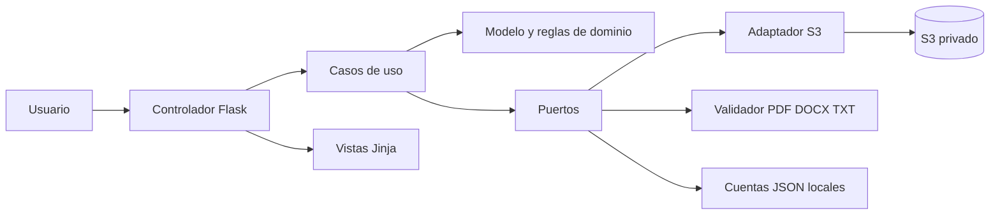

# Arquitectura MVC y hexagonal pragmática

## Organización solicitada

La aplicación de referencia tiene `models`, `views` mediante plantillas, `controllers`, servicios y un repositorio S3 inyectable. Esto proporciona una base MVC. La nueva implementación debe hacer explícita la separación hexagonal sin alterar el producto: reglas independientes de HTTP y AWS, puertos pequeños y adaptadores sustituibles.

MVC organiza la interacción con el usuario. Hexagonal organiza las dependencias. Son compatibles: los controladores MVC son adaptadores de entrada, las vistas son presentación y el modelo de dominio se usa mediante casos de uso. El repositorio S3 es un adaptador de salida.



## Estructura orientativa

```text
app/
  domain/
    document.py          # ficha conceptual, identidad, relación y archivo validado
    user.py              # cuenta y permisos sin acceso al disco
    errors.py            # errores de dominio y resultados de casos de uso
    policies.py          # reglas de metadatos/duplicados/relaciones
  application/
    ports.py             # contratos de repositorio, cuentas y validación
    document_service.py  # alta, listado, detalle y descarga
    auth_service.py      # autenticación como caso de uso
    dto.py               # entradas/salidas independientes de Flask
  adapters/
    web/
      controllers/       # blueprints, traducción HTTP y sesión
      templates/         # vistas MVC
      static/css/
      security.py        # CSRF, cabeceras, permisos HTTP y limitador local
    persistence/
      s3_repository.py   # Boto3, claves, JSON, errores y streams
      record_mapper.py   # mapeo a schema_version=1 y validación de fichas
      json_user_store.py # lectura/escritura de cuentas locales
    validation/
      file_validator.py  # pypdf, python-docx, ZIP y UTF-8
  bootstrap.py           # composición e inyección de dependencias
  config.py
  __init__.py            # create_app, sin ejecutar servidor al importar
config/catalogo.json
scripts/
tests/
docs/
instance/                # ignorado por Git
run.py
```

Es una propuesta para generar/refactorizar, no la estructura que ya existe. Flask debe recibir las rutas correctas de `template_folder` y `static_folder` si se mueven las vistas. Se admite conservar `app/controllers/` y `app/templates/` como adaptadores de entrada si se respeta la dirección de dependencias. No renombrar todo por estética.

## Qué pertenece a cada capa

**Dominio:** significado de identidad lógica, valores permitidos, declaración borrador/final, relación y motivos; no importa Flask, Werkzeug de peticiones, Boto3, pypdf ni python-docx. Puede usar dataclasses y tipos estándar.

**Aplicación:** orquesta autorización, validación, consulta de duplicados, relaciones y guardado; retorna DTO o errores tipados. Recibe usuario ya autenticado y valida sus permisos en el límite de caso de uso. No recibe `request.form` directamente: convertirlo antes a un objeto o diccionario permitido.

**Presentación:** controladores convierten formularios, llaman casos de uso y traducen resultados a HTML, códigos HTTP, flashes o descarga. Plantillas no consultan S3, no calculan hashes ni deciden relaciones válidas. Un atributo HTML `required` solo mejora la interacción.

**Adaptadores:** lectura real de cuentas, inspección binaria, SDK AWS y mapeo de fichas. Los errores externos se convierten en fallos propios; no llegan `ClientError`, streams SDK o FileStorage al núcleo.

**Composición:** crea una instancia compartida del servicio y su bloqueo, repositorio S3, validador y almacén de usuarios. Inyecta dobles en pruebas. No construir un cliente AWS por cada llamada de dominio ni conectar con AWS al importar módulos.

## Puertos pequeños

Propuesta de firmas conceptuales; elegir nombres coherentes con la implementación:

```python
class DocumentRepository(Protocol):
    def list_all(self) -> list[Document]: ...
    def get(self, document_id: str) -> Document: ...
    def save(self, document: Document, content: bytes) -> None: ...
    def download(self, document: Document, max_bytes: int) -> bytes: ...

class UserRepository(Protocol):
    def get_active(self, username: str) -> User | None: ...

class FileValidator(Protocol):
    def validate(self, stream: BinaryIO, filename: str,
                 max_bytes: int) -> ValidatedFile: ...
```

Son interfaces de diseño, no un módulo ejecutable: faltan deliberadamente imports y definiciones del proyecto. El servicio puede añadir puertos de verificación de contraseña, reloj e ID si ayudan a probarlo. No crear una abstracción para cada función trivial.

El adaptador S3 genera `archivo.clave_s3` al serializar la ficha; el dominio no consulta `repository.prefix` ni conoce nombres de buckets. La firma existente de creación puede refactorizarse internamente, pero el JSON almacenado debe permanecer compatible. Si se adopta un DTO de persistencia separado, mantener un mapeador único.

## Casos de uso y dependencias

| Caso | Entrada | Resultado |
|---|---|---|
| Autenticar | Login y contraseña | Usuario activo o fallo genérico. |
| Incorporar | Actor, metadatos, archivo, relación propuesta | Ficha guardada, duplicado, candidatas o error. |
| Listar | Actor y filtros permitidos | Fichas que cumplen filtros y orden. |
| Consultar | Actor y UUID | Detalle o no encontrado. |
| Descargar | Actor y UUID | Bytes verificados, MIME y nombre de presentación. |

En el piloto, leer todos los JSON y filtrar en Python es una decisión consciente. Llevar esa operación al caso de uso para poder probar filtros sin Flask. La descarga verifica integridad en el adaptador o servicio especializado y retorna contenido seguro al controlador.

## Adaptación de la base existente

El código actual ya permite inyectar `repository` en `create_app`; conservar esa capacidad. `DocumentService` está separado de Flask, pero recibe un diccionario parecido al formulario y consulta `repository.prefix`. `validation.py` mezcla reglas de metadatos con parsers. Los controladores de catálogo/detalle/descarga llaman directamente al repositorio. Para una separación hexagonal más explícita, introducir DTO, mover reglas puras a dominio, encapsular inspección en adaptador y enrutar esas operaciones por casos de uso.

No afirmar que esos cambios ya se han realizado por añadir esta skill. Esta entrega modifica documentación, no la aplicación. Una futura refactorización debe demostrar equivalencia mediante las pruebas de aceptación.

## Concurrencia coherente con el diseño

La exclusión mutua cubre consulta de fichas, detección de duplicado, relación y escritura de ambos objetos. Compartir una instancia del servicio por proceso. Crear un Lock por petición elimina su utilidad. Validar bytes antes de entrar en la sección crítica cuando sea seguro para reducir el tiempo de bloqueo.

Este mecanismo no coordina dos procesos, dos equipos o un proceso y una herramienta externa que escriban en el mismo prefijo. Documentar y mantener un único escritor de aplicación. S3 puede atender muchos clientes, pero este algoritmo de duplicados no es distribuido. No añadir varios workers de servidor como supuesto ajuste de rendimiento.
